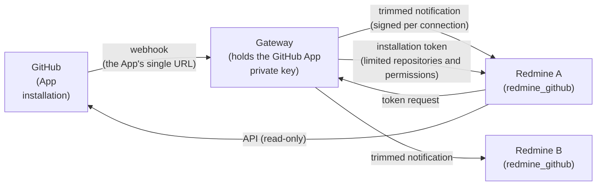
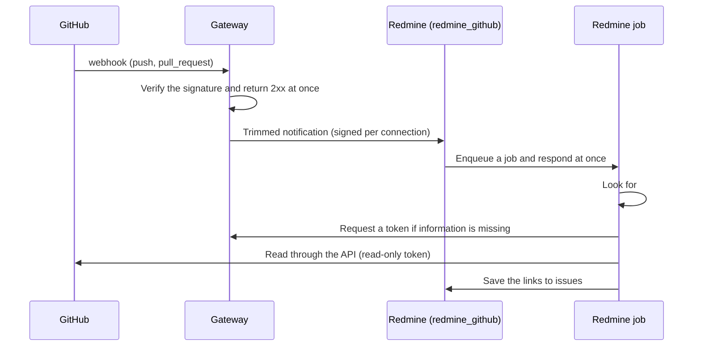

# Design

This is the design of a plugin that replaces Redmine's standard repositories with GitHub repositories. It is at the design stage.

## Decisions (2026-11-09)

| Item | Decision |
| --- | --- |
| Form | A Redmine plugin, `redmine_github`. It is a separate plugin from `redmine_serverless` in Serverless, so that it also works with Redmine on an ordinary server |
| Goal | Connect to GitHub repositories instead of Redmine's standard repositories (Git repositories stored on the server) |
| First feature | Show the related commits and pull requests (with their state and a link to GitHub) on the issue page |
| How it connects | A shared gateway (see [Shared gateway](#shared-gateway-proposal) below) holds the GitHub App. Redmine does not connect to GitHub directly; it connects behind the gateway. One GitHub App and gateway can serve many Redmines |
| Gateway URL | The plugin connects to the gateway whose URL is set in the plugin settings. Any gateway that follows the protocol can be used |
| Name | `redmine_github`. Another plugin has the same name (agileware-jp/redmine_github), which is acceptable |

## Shared gateway (proposal)

All communication with the GitHub App goes through a shared component outside Redmine (the gateway). The Redmine plugin talks only to the gateway.

### Why one shared gateway

- **The App has one webhook URL:** A GitHub App registration sets a single webhook URL (GitHub documentation). To use one App with many organizations or many Redmines, something has to receive the notifications and route them.
- **The private key stays in one place:** Creating an installation token requires a JWT signed with the App's private key (RS256, valid for at most 10 minutes) (GitHub documentation). If only the gateway holds the private key, Redmine needs neither the App's private key nor any long-lived credentials.
- **The Redmine side stays small:** The gateway handles signature checks, redelivery detection, responding within 10 seconds, and retries. The plugin only receives trimmed notifications and links them to issues.
- **It works for other tools too:** What sits behind the gateway does not have to be Redmine, so other tools can connect to GitHub the same way.

### What the gateway does

| Task | Details |
| --- | --- |
| Receive notifications | Receive the App's webhooks, verify the signature (`X-Hub-Signature-256`), and detect redeliveries of the same notification by `X-GitHub-Delivery`. Return a 2xx within 10 seconds and process the payload later from a queue (the approach GitHub documentation recommends) |
| Route | Find the connected Redmines from the installation and repository, and send a trimmed notification only where it is needed (commit SHA, message, author, URL, pull request number, title, state, URL, and so on). If delivery fails, retry after a delay |
| Issue tokens | On a request from Redmine, create and return an installation token. The token is limited to the connected repositories and to read-only permissions (metadata, contents, pull requests). It expires after 1 hour (GitHub's rule) |
| Manage connections | The links between Redmines and installations (see [Connecting a Redmine](#connecting-a-redmine) below) and the secret for each connection |

- **Keep notifications small:** The gateway does not pass GitHub's notifications through as they are. It trims them to the fields that are needed. This lets a Redmine with a limit on request body size (1 MB), such as Serverless, receive them.
- **Keep nothing:** Notification payloads (commit messages and so on) are kept only while retries are pending and are deleted after a set period. The gateway neither reads nor stores code.

### Connecting a Redmine

1. A Redmine administrator starts the connection process to the gateway from the plugin settings.
2. A GitHub organization administrator installs the GitHub App in their organization and selects the repositories it may use.
3. The gateway uses GitHub user authorization (an App user access token) to check that the person who started the process can manage that installation, and then links the installation to the Redmine. This prevents anyone from linking another organization's installation to their own Redmine.
4. The gateway creates a secret for the connection and gives it to Redmine. Redmine uses this secret to verify the signature on notifications from the gateway and to request tokens.

### Protocol between the gateway and Redmine

- **Notifications:** The gateway POSTs trimmed notifications to the plugin's endpoint (path to be decided). It signs the body and timestamp with the connection's secret. The plugin checks the signature, the timestamp (rejecting notifications that are too old), and the notification ID (to detect redeliveries).
- **Tokens:** The plugin requests tokens from the gateway with the connection ID and a signature.
- **Published protocol:** This protocol is published in this repository's documentation. The plugin can connect to any gateway that follows it.
- **Gateway URL:** The plugin settings hold the gateway's URL. People who use the plugin do not create a GitHub App themselves; they install the plugin and follow the connection steps. To switch gateways, change the URL in the settings.

## Flow (proposal)

- **Finding links:** `#123` in commit messages and in pull request titles and bodies is read as an issue number. Whether to follow Redmine's standard "Referencing keywords" setting is listed under [Open questions](#open-questions) below.
- **Permissions:** The issue page shows commits and pull requests only to people who can view that issue. Which Redmine users may see commits from a private GitHub repository is decided by the link between the project and the repository.

## Replacing local repositories (under consideration)

Under consideration: plugging into Redmine's standard repository framework (the `Repository` model, the `Redmine::Scm::Adapters` adapters, commit import, and the repository pages) as a repository type that uses the GitHub API.

| Approach | Pros | Cons |
| --- | --- | --- |
| Add a repository type (a type such as `Repository::Github` and a GitHub API adapter) | Redmine's standard commit list, issue-commit links, "Fixing keywords", and repository pages work as they are | The standard adapters assume they return the output of a local command (`git`), so it needs checking whether they can be replaced with the API. Serving file browsing and diffs through the API tends to hit the API rate limits |
| Own display only (custom tables and a hook on the issue page) | Small to build. Little dependence on Redmine internals | Redmine's standard repository features (commit list, status changes by keyword, and so on) are not available |

## Using it with Serverless

- **Notification size:** In Serverless, request bodies through CloudFront are limited to 1 MB. Because the gateway sends small trimmed notifications, large GitHub push webhooks are unlikely to hit this limit. If a notification is still over 1 MB after trimming, it is sent in parts.
- **Jobs:** In Serverless, ActiveJob jobs run on `redmine-worker` through SQS. This plugin uses only ActiveJob's standard mechanisms.
- **Outbound traffic:** The plugin calls the GitHub API, so Redmine must be able to reach GitHub.

## Open questions

- How to replace local repositories (add a repository type, or own display only)
- Whether to publish the gateway implementation (so that anyone can run their own gateway and GitHub App)
- How to protect the gateway's private key (whether signing can be done in a key management service so that the private key cannot be extracted; not checked yet)
- Where Redmine stores the secret for each connection (an environment variable, or an encrypted Redmine setting)
- Details of the protocol between the gateway and Redmine (notification format, signature format, path)
- How to link Redmine projects to GitHub repositories (one-to-one or many) and who can decide this
- How to find issue numbers (follow Redmine's "Referencing keywords", or `#123` only)
- Supported Redmine versions (`requires_redmine`)
- License (as a Redmine plugin, GPL-2.0-or-later is the candidate)
