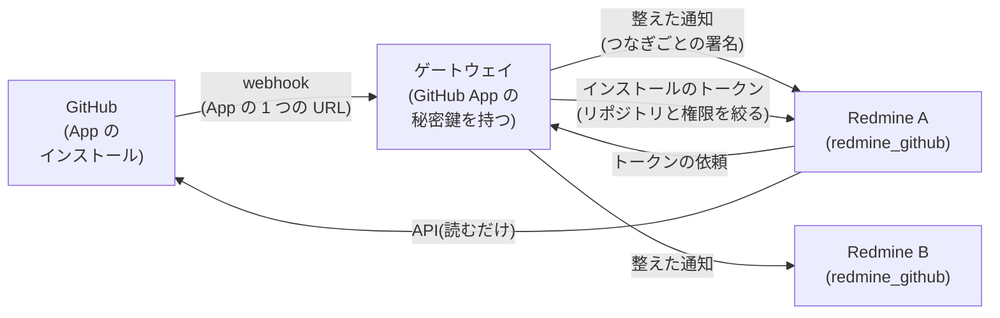
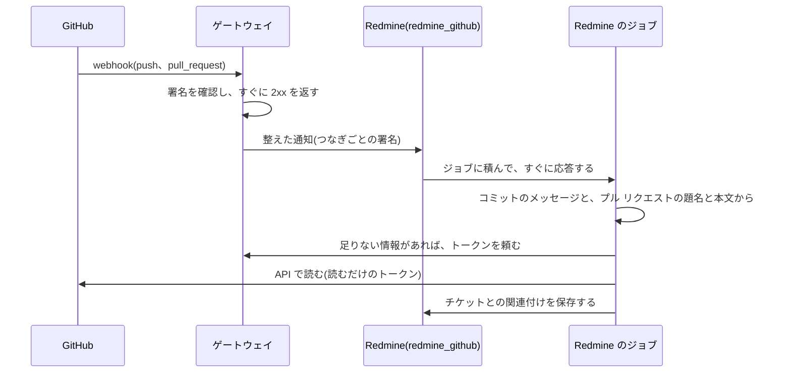

# 設計

Redmine の標準のリポジトリを、GitHub のリポジトリで置き換えるプラグインの設計です。今は検討段階です。

## 決めたこと(2026-11-09)

| 項目 | 決めたこと |
| --- | --- |
| 形 | Redmine のプラグイン `redmine_github`。Serverless の `redmine_serverless` とは別のプラグインにし、ふつうのサーバーの Redmine でも使えるようにする |
| 目的 | Redmine の標準のリポジトリ(サーバーに置いた Git のリポジトリ)の代わりに、GitHub のリポジトリとつなぐ |
| 最初にできること | チケットの画面に、関わるコミットとプル リクエスト(状態と、GitHub へのリンク)を出す |
| つなぎ方 | GitHub App を、共通のゲートウェイ(下の「共通のゲートウェイ」)が持つ。Redmine は、GitHub に直接つながず、ゲートウェイの先につながる。1 つの GitHub App とゲートウェイを、複数の Redmine で使える |
| ゲートウェイの URL | プラグインは、プラグインの設定の URL のゲートウェイにつなぐ。決まりに合うゲートウェイなら、どれにでもつなげる |
| 名前 | `redmine_github`。同じ名前のほかのプラグイン(agileware-jp/redmine_github)があるが、かまわない |

## 共通のゲートウェイ(案)

GitHub App とのやり取りを、Redmine の外の共通の仕組み(ゲートウェイ)にまとめます。Redmine のプラグインは、ゲートウェイとだけ話します。

### 共通にする理由

- **App の webhook の URL は 1 つ:** GitHub App の登録には、webhook の URL を 1 つ決めます(GitHub の資料)。1 つの App を、複数の組織や複数の Redmine で使うなら、通知を受けて振り分ける所が要ります。
- **秘密鍵を 1 か所に:** インストールのトークンを作るには、App の秘密鍵で署名した JWT(RS256、期限は 10 分まで)が要ります(GitHub の資料)。秘密鍵をゲートウェイだけが持てば、Redmine の側には、App の秘密鍵も、長く使える認証情報も置かずに済みます。
- **Redmine の側が小さくなる:** 署名を確認し、届き直しの見分け、10 秒以内の応答、やり直しを、ゲートウェイにまとめます。プラグインは、整えた通知を受けて、チケットに結び付けるだけになります。
- **ほかの道具にも使える:** ゲートウェイの先は Redmine に限らないので、同じ形で、ほかの道具を GitHub につなぐこともできます。

### ゲートウェイがすること

| すること | 中身 |
| --- | --- |
| 通知を受ける | App の webhook を受け、署名(`X-Hub-Signature-256`)を確認し、`X-GitHub-Delivery` で同じ通知の届き直しを見分ける。10 秒以内に 2xx を返し、中身はキューで後から処理する(GitHub の資料が勧める形) |
| 振り分ける | インストールとリポジトリから、つないだ Redmine を探し、要るところだけに整えた通知を送る(コミットの SHA、メッセージ、作者、URL、プル リクエストの番号、題名、状態、URL など)。届かなければ、間を置いてやり直す |
| トークンを渡す | Redmine の依頼で、インストールのトークンを作って渡す。トークンは、つないだリポジトリだけ、読むだけの権限(メタデータ、中身、プル リクエスト)に絞る。期限は 1 時間(GitHub の決まり) |
| つなぎを管理する | Redmine とインストールの結び付け(下の「つなぐ手順」)と、つなぎごとの秘密の値 |

- **通知を小さくする:** GitHub の通知をそのまま渡さず、要る項目だけに整えて渡します。Serverless のように、要求の本文に上限(1 MB)がある Redmine でも受けられます。
- **残さない:** 通知の中身(コミットのメッセージなど)は、やり直しのあいだだけ残し、決めた期間で消します。ゲートウェイは、コードを読みも残しもしません。

### つなぐ手順

1. Redmine の管理者が、プラグインの設定から、ゲートウェイにつなぐ手続きを始めます。
2. GitHub の組織の管理者が、GitHub App を自分の組織に入れ、使わせるリポジトリを選びます。
3. ゲートウェイが、GitHub の利用者の認可(App のユーザーのトークン)で、手続きをした人がそのインストールを管理できる人かを確認してから、インストールと Redmine を結び付けます。ほかの組織のインストールを、自分の Redmine に結び付けられないようにするためです。
4. ゲートウェイが、つなぎごとの秘密の値を作り、Redmine に渡します。Redmine は、この値で、ゲートウェイからの通知の署名を確認し、トークンの依頼に使います。

### ゲートウェイと Redmine のあいだの決まり

- **通知:** ゲートウェイは、プラグインの受け口(パスは決める)に、整えた通知を POST します。本文と時刻に、つなぎごとの秘密の値で署名を付けます。プラグインは、署名と時刻(古すぎる通知は断る)と、通知の ID(届き直しの見分け)を確認します。
- **トークン:** プラグインは、つなぎの ID と署名で、ゲートウェイにトークンを頼みます。
- **決まりの公開:** この決まりは、このリポジトリの資料で公開します。決まりに合うゲートウェイなら、どれにでもつなげます。
- **ゲートウェイの URL:** プラグインの設定に、ゲートウェイの URL を持ちます。使う人は、GitHub App を自分で作らず、プラグインを入れて、つなぐ手順を進めるだけで使えます。ゲートウェイを替えるときは、設定で URL を変えます。

## 流れ(案)

- **関連付けの見つけ方:** コミットのメッセージと、プル リクエストの題名と本文の `#123` を、チケットの番号として読みます。Redmine の標準の「参照用キーワード」の設定に合わせるかは、下の「まだ決めていないこと」で決めます。
- **権限:** チケットの画面に出すのは、そのチケットを見られる人だけです。GitHub の非公開のリポジトリのコミットを、Redmine の誰に見せてよいかは、プロジェクトとリポジトリの結び付けで決めます。

## ローカルのリポジトリを置き換える形(検討)

Redmine の標準のリポジトリの仕組み(`Repository` のモデル、`Redmine::Scm::Adapters` のアダプター、コミットの取り込み、リポジトリの画面)に、GitHub の API を使うリポジトリの種類として入る形を検討します。

| 形 | 良いところ | 足りないところ |
| --- | --- | --- |
| リポジトリの種類として入る(`Repository::Github` のような種類と、GitHub の API のアダプター) | Redmine の標準のコミットの一覧、チケットとコミットの関連付け、「修正を示すキーワード」、リポジトリの画面をそのまま使える | 標準のアダプターは、ローカルのコマンド(`git`)の結果を返す前提なので、API に置き換えられるかを確認する必要がある。ファイルの閲覧や差分を API で返すと、呼び出しの回数の上限に当たりやすい |
| 自前の表示だけ(独自のテーブルと、チケットの画面のフック) | 作りが小さい。Redmine の内部への依存が少ない | Redmine の標準のリポジトリの機能(コミットの一覧、キーワードでの状態の変更など)は使えない |

## Serverless で使うとき

- **通知の大きさ:** Serverless では、CloudFront を通る要求の本文が 1 MB までです。ゲートウェイが整えた小さな通知を送るので、GitHub の push の webhook が大きくても当たりにくくなります。整えたあとも 1 MB を超えるときは、分けて送ります。
- **ジョブ:** Serverless では、ActiveJob のジョブは SQS で `redmine-worker` が動かします。このプラグインは、ActiveJob の標準の仕組みだけを使います。
- **外への通信:** GitHub の API を呼ぶので、Redmine から GitHub に届く必要があります。

## まだ決めていないこと

- ローカルのリポジトリを置き換える形(リポジトリの種類として入るか、自前の表示だけか)
- ゲートウェイの実装を公開するか(だれでも自分のゲートウェイと GitHub App を立てられるようにするか)
- ゲートウェイの秘密鍵の守り方(鍵の管理のサービスで署名し、秘密鍵を取り出せないようにできるか。未確認)
- つなぎごとの秘密の値の、Redmine の側の置き場所(環境変数か、暗号化した Redmine の設定か)
- ゲートウェイと Redmine のあいだの決まりの細部(通知の形、署名の形、パス)
- Redmine のプロジェクトと GitHub のリポジトリの結び付け方(1 対 1 か、複数か)と、それを決められる人
- チケットの番号の見つけ方(Redmine の「参照用キーワード」に合わせるか、`#123` だけか)
- 対応する Redmine のバージョン(`requires_redmine`)
- ライセンス(Redmine のプラグインなので、GPL-2.0-or-later を候補にする)
